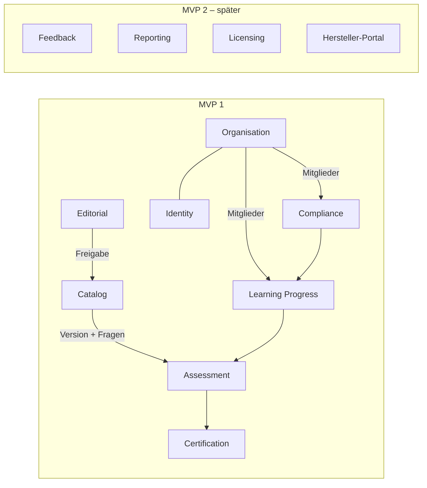

# PharmaTraining – Domänenmodell & MVP

> Fachliche Spezifikation von PharmaTraining (MVP 1). Quelle für alle Issues: Entscheidungen, Glossar,
> Event-Verträge, Aggregate, Endpunkte und Issue-Plan. Der Code-Entwurf der Aggregate und ihrer Tests liegt unter
> [`reference/`](reference/); er ist eine Spezifikation, nicht kompiliert, und wird von den Backend-Issues ins
> generierte Projekt übernommen.

Stand: 2026-11-18 · Heiko Weiß

## Vision und Zielbild

Eine kuratierte Schulungsplattform für Apotheken: Pflichtschulungen mit Test und Nachweis, dazu Produktschulungen von Herstellern mit anonymem Feedback.

- **Problem:** Apothekenleiter müssen ihr Team regelmäßig unterweisen und das nachweisen. Heute läuft das oft über Papier, PDFs und Unterschriftenlisten.
- **Nutzer:** Apothekenleiter (verwalten, weisen zu, prüfen Nachweise), Mitarbeiter wie PTA, PKA und Apotheker (lernen, testen), Redaktion (pflegt Inhalte und Fragen), später Hersteller (liefern Produktinhalte, erhalten Feedback).
- **Geschäftsmodell:** Apotheken zahlen für das Compliance-Modul. Hersteller zahlen für Reichweite und Feedback ihrer Produktschulungen. Produktschulungen sind für Apotheken kostenlos.
- **Zielgruppe zuerst:** Apotheken. Arztpraxen und Pflegeeinrichtungen kommen später.

## Entscheidungen

Stand der Diskussion vom 17.11.2026.

| Thema | Entscheidung | Begründung |
| --- | --- | --- |
| Plattformtyp | Kuratiert, kein offener Marktplatz | Hersteller liefern zu, die Redaktion gibt frei. Im Medizinbereich nötig. |
| Erste Zielgruppe | Nur Apotheken | Keine vorzeitige Abstraktion; Pflege und Praxen später über Organisation |
| Reihenfolge | MVP 1 Compliance, MVP 2 Hersteller | Hersteller zahlen erst bei Reichweite; Pflichtschulungen schaffen sie |
| Pflichtinhalte | Eigene Redaktion, fachlich gestützt auf BAK und BGW | Kein gesetzlich genormter Inhalt; Verlagslizenz wäre Abhängigkeit vom Wettbewerber |
| Person vs. Apotheke | Person ist unabhängig, Mitgliedschaft verbindet sie mit der Apotheke | PTAs wechseln den Arbeitgeber; Nachweise gehören der Person |
| Nachweise bei Austritt | Apotheke behält Snapshot ihrer Nachweise | Dokumentationspflicht der Apotheke |
| Verwalter | MVP: nur Apothekenleiter; Rechte über Fähigkeiten, nicht über Rollennamen | Weitere Rollen (QMS, Filialleitung) ohne Umbau möglich |
| Login | E-Mail über externen Identity Provider | Login ohne E-Mail später als IdP-Konfiguration |
| Geräte | Responsive Web für Desktop und Tablet, Fortschritt serverseitig | Am PC beginnen, am Tablet fortsetzen |
| Zuweisung | Manuell mit Frist, optional jährliche Wiederholung | Regeln nach Rolle und Alter erst später |
| Bestehensgrenze | Pro Schulung einstellbar, Standard 80 % | Unterschiedliche Schwierigkeit je Thema |
| Versuche | Nach 3 Fehlversuchen Inhalt erneut durcharbeiten | Später evtl. konfigurierbar |
| Fragentypen | Single und Multiple Choice | Fragenpools mit Zufallsauswahl später |
| Test-Freischaltung | Erst nach vollständigem Durcharbeiten des Inhalts | Belastbarer Nachweis |
| Teilnahmebestätigung | PDF mit Name, Schulung + Version, Datum, Ergebnis, gültig bis; QR-Verifikation; ohne Apotheke, da personenbezogen | Überzeugt bei Begehung und Prüfung |
| Feedback | Eigener Context, keine Personen-ID, Mindestanzahl Antworten | Echte Anonymität (MVP 2) |
| Gesponserte Inhalte | Nie bei Pflichtschulungen, immer gekennzeichnet | Glaubwürdigkeit der Redaktion |
| Neue Schulungsversion | Begonnene Durchläufe bleiben auf der alten Version, nicht begonnene wechseln auf die neue | Laufende Nachweise brechen nicht; „erfordert Neuschulung“ später |
| Benachrichtigung | Keine E-Mails in MVP 1 außer der Einladung, die Organisation selbst per SMTP sendet; Dashboard listet zugewiesene Schulungen, Überfällige hervorgehoben | Einfach starten, E-Mail später; die Einladung braucht den Link (Entscheidung zu #9, 2026-11-21) |
| Aufbewahrung | 5 Jahre ab Ausstellung der Bestätigung, von der Apotheke verlängerbar, nie unter 2 Jahre; danach löscht die Apotheke ihre Kopie automatisch. Die Bestätigungen der Person bleiben in ihrem Konto | TRGS 555 verlangt mind. 2 Jahre (Gefahrstoffe); AK Westfalen-Lippe empfiehlt 5 Jahre (Gefahrstoffe, Hygiene); datensparsamer als ab Austritt |
| Abgrenzung zum Wettbewerb | Kern ist Compliance-Steuerung: Zuweisung, Fristen, Wiederholung, Status, Nachweis-Export | Wettbewerber verkaufen Inhalte, wir verkaufen Sicherheit bei der Begehung |
| Gültigkeit | Pro Schulung festgelegt, Standard 12 Monate, abgeleitet aus dem Wiederholungsintervall | Z. B. Ersthilfe 24 Monate |
| Status einer Zuweisung | offen → in Bearbeitung → abgeschlossen; überfällig bei verstrichener Frist; gesperrt nach 3 Fehlversuchen als Unterzustand | Einfaches, verständliches Modell |
| Nach Fristablauf | Abschluss weiter möglich, Vermerk „verspätet“ | Später Nachweis ist besser als keiner |
| Ansicht Apothekenleiter | Matrix Mitarbeiter × Schulung mit Statusfarben plus Compliance-Quote | Auf einen Blick sehen, wo Lücken sind |
| Sprache im Code | Domain Model und Events auf Englisch, UI auf Deutsch und Englisch (Deutsch als Rückfall, Wahl nach Browser und Umschalter) | Entscheidung vom 22.11.2026 (#146); Glossar führt beide Begriffe |
| Architektur | Ein Service pro Context von Anfang an (backend.topology: services). Fabric bekommt dafür erst den Services-Pack (ADR-0017, PR #702, Issues #703–#708); PharmaTraining wird danach direkt mit services generiert | Entscheidung von Heiko; Option ist in Fabric noch experimental |
| Zuweisung und Lernen | Learning und Assessment kennen keine Zuweisungen; Compliance gleicht über Events ab; Überfällig ist berechnet | Lose Kopplung zwischen den Services |
| Frühere Bestätigungen, Teilzeit, Fristen, Austritt | Alte Bestätigung zählt in MVP 1 nicht; mehrere Apotheken erlaubt; nächste Frist ab Abschluss + Intervall; Frist änderbar mit Historie; bei Austritt offene Zuweisungen storniert | Runde 10 |
| Tenancy | backend.tenancy: none; Apotheke als Domänenbegriff | Event Sourcing (Marten) verlangt tenancy none; Person, Catalog, Redaktion sind apothekenübergreifend |
| Event Sourcing | Learning Progress und Assessment event-sourced (Marten), Rest DDD | Der Event-Stream ist der Audit-Trail |
| Frontend | Vue.js | In Fabric experimental, zusammen mit services zwei experimentelle Optionen |
| LLM in MVP 1 | Fragen-Generierung und Inhaltsprüfung für die Redaktion | LLM entwirft, Mensch entscheidet; bewertet nie Tests |
| Redaktion | Inhalte entstehen nur durch die Redaktion, keine externen Fachautoren im System | Runde 12 |
| Video | MP4 in Blob Storage in MVP 1, Fortschritt über Player-Events; adaptives Streaming später | Nachweis „bis zum Ende gesehen“ |
| Test-Generierung | LLM entwirft den kompletten Test einer Schulung; Redakteur prüft, ändert, gibt frei | Größte Zeitersparnis für die Redaktion |
| Redaktions-Workflow | Draft → InReview → Published → Retired; Vier-Augen-Freigabe als Einstellung, zunächst aus | Solange die Redaktion aus einer Person besteht |
| Herkunft der Fragen | Jede Frage vermerkt „KI-entworfen, geprüft von X am Y“ | Nachweis, dass ein Mensch jede Frage freigegeben hat |
| LLM-Anbieter | azure-openai mit EU-Region | DSGVO, Gesundheitsbereich; in Fabric supported |
| LLM-Evals | `backend.llm.extras: evals` von Anfang an | E8 prüft den KI-Testentwurf mit dem generierten Evals-Job |
| Testvorgaben | Pro Schulung gespeichert; Standard 10 Fragen, gleichmäßig auf Kapitel verteilt | Testentwurf reproduzierbar nach Inhaltsänderung |
| Identity | Kein eigener Service; PersonId = Keycloak-Subject; Anzeigename pflegt Organisation | Ein Identity-Service hätte in MVP 1 nichts zu tun |
| Catalog | Eigener Service als Read Model aus CourseVersionPublished | Lernende kommen nie an die Redaktions-API |
| Event-Verträge | Inhalt und Testdefinition getrennt; keine Namen in event-sourced Streams; Compliance schließt nach CourseId | Lösungen nie im Frontend; DSGVO-Löschung; Teilzeit in zwei Apotheken |
| Video vollständig | Vorspulen nur bis zur bisher gesehenen Stelle; erledigt ab 95 %; Server prüft Plausibilität der Zeit | Maximale Position allein lässt Vorspulen ans Ende zu |
| Text und PDF vollständig | Bis zum Ende gescrollt bzw. letzte Seite angezeigt; keine Mindestverweildauer | Mindestdauer nervt und ist leicht auszutricksen |
| Nach 3 Fehlversuchen | Nur die Kapitel der falsch beantworteten Fragen werden zurückgesetzt; AttemptsExhausted trägt deren ChapterIds | Nutzerfreundlicher; jede Frage ist über die Testvorgaben einem Kapitel zugeordnet |
| Testablauf | Fragen und Antwortoptionen pro Versuch gemischt; kein Zeitlimit; nach Bestehen keine Wiederholung | Erschwert Abschreiben; bestanden ist bestanden |
| Keine Primitive im Model | module.ddd-depth: strict in allen Services; Zeit als Timestamp/CalendarDate, Zustände als Enums, Domain-Methoden ohne Uhr (Zeit wird übergeben) | Architekturregel in Fabric prüft es |
| Projektname | PharmaTraining; Namespace SmartSolutionsLab.PharmaTraining | Entscheidung von Heiko |
| Bewertung Multiple Choice | Keine Teilpunkte: richtig nur bei genau den richtigen Optionen | Bei Pflichtschulungen üblich und gut begründbar |
| Gemeinsame Bausteine | Kein Shared Kernel: jeder Service hat eigene PersonId, CourseId, Timestamp | Ein gemeinsames Paket würde die Services wieder koppeln |
| Mitgliedschaften | Entities in Pharmacy; Name kommt beim Annehmen aus Keycloak; Einladung läuft nach 14 Tagen ab und geht per Mail, die Organisation über SMTP sendet; der Link trägt ein Token, gespeichert wird nur sein Hash | Regeln zur letzten Leitung und Doppel-Mitgliedschaft in einer Transaktion; Person pflegt ihren Namen selbst |
| Tätigkeiten im Code | Pharmacist, Pta, Pka, Trainee, Other | PTA und PKA sind Fachbegriffe ohne saubere Übersetzung |
| Fragen und Bestätigungen | Fragen gehören zur Version, kein Pool in MVP 1; kein Widerruf von Bestätigungen; PDF einmal beim Ausstellen erzeugt und gespeichert | Nachweis bleibt identisch, auch wenn sich Name oder Layout ändern |
| Uploads | Direkt vom Browser in den Blob Storage über kurzlebige Upload-URL von Editorial | Große Videos belasten weder API noch Edge |
| Ergebnis nach Fehlversuch | Punktzahl, bestanden ja/nein, zu wiederholende Kapitel; keine richtigen Antworten | Sonst kursiert die Lösung im Team |
| Rolle Redaktion | Keycloak-Realm-Rolle editor, getrennt von den Apothekenrollen in Organisation | Plattform-Mitarbeiter sind keine Apothekenmitglieder |
| Matrix und Startversion | Matrix zeigt nur in der Apotheke zugewiesene Schulungen; begonnene Session bleibt auf ihrer Version, sonst aktuelle Version (Compliance hält sie) | Übersichtlich; konsistent mit Runde 9 |
| Nachweis-Export | In Certification als ZIP mit PDFs und CSV, nur Bestätigungen aus der Beschäftigungszeit | PDFs liegen dort; kein synchroner Aufruf zwischen Services |
| Zuweisungen bei Austritt | Austritt storniert offene und begonnene Zuweisungen der Person in dieser Apotheke, nicht abgeschlossene und nicht die anderer Apotheken; die Historie nennt die ausgetretene Person und „Mitgliedschaft beendet“; nichts wird storniert, solange sie dort eine weitere aktive Mitgliedschaft hat | Das Event nennt niemanden sonst; eine erneut eingeladene Person hat eine neue Mitgliedschaft (#30) |
| Eigene Zuweisungen | Eine Leitung ändert oder zieht keine Zuweisung zurück, deren Lernende sie selbst ist (403 `compliance.own-assignment`); das tut eine andere Leitung der Apotheke | Vorgabe des Orchestrators bei #269, die der Owner überstimmen kann |

## Glossar (Ubiquitous Language)

Diese Begriffe gelten in Code, Tickets und Gesprächen gleichermaßen.

| Begriff (UI) | Code | Bedeutung | Context |
| --- | --- | --- | --- |
| Person | `Person` | Ein Mensch mit Login, unabhängig vom Arbeitgeber | Identity |
| Apotheke | `Pharmacy` | Kunde der Plattform; Domänenbegriff, kein technischer Mandant | Organisation |
| Mitgliedschaft | `Membership` | Verbindung Person ↔ Apotheke mit Rolle und Tätigkeit, zeitlich begrenzt | Organisation |
| Apothekenleiter | `PharmacyManager` (Rolle) | Rolle mit Fähigkeit, Mitarbeiter und Schulungen zu verwalten | Organisation |
| Tätigkeit | `JobFunction` | PTA, PKA, Apotheker, Azubi; später Basis für Pflichtregeln | Organisation |
| Schulung | `Course` | Fachlicher Inhalt mit Kapiteln, optional Test | Editorial / Catalog |
| Schulungsversion | `CourseVersion` | Freigegebene, unveränderliche Fassung; alle Nachweise verweisen darauf | Catalog |
| Frage | `Question` | Versionierte Prüfungsfrage, nach Freigabe unveränderlich | Editorial / Assessment |
| Zuweisung | `Assignment` | Pflicht einer Person, eine Schulung bis zu einer Frist abzuschließen | Compliance |
| Wiederholung | `RecurrenceInterval` | Intervall, nach dem eine neue Zuweisung entsteht | Compliance |
| Lerndurchlauf | `LearningSession` | Person × Schulungsversion mit Fortschritt pro Kapitel | Learning Progress |
| Testversuch | `TestAttempt` | Ein Durchlauf des Tests mit Fragenversionen, Antworten, Ergebnis | Assessment |
| Teilnahmebestätigung | `Certificate` | Nachweis über bestandene Schulung, mit QR-Verifikation | Certification |
| Feedback-Abgabe | `FeedbackSubmission` | Anonyme Antwort ohne Personenbezug | Feedback (MVP 2) |

Events: `CourseAssigned`, `ContentCompleted`, `TestPassed`, `TestFailed`, `SessionLocked`, `CertificateIssued`, `AssignmentCompleted`.

## Bounded Contexts und Context Map

MVP 1 besteht aus acht Contexts. Der Kernfluss läuft von der Zuweisung über das Lernen und den Test bis zum Nachweis.

Learning Progress, Assessment und Certification verweisen immer auf eine konkrete Schulungsversion aus dem Catalog, nie auf die Schulung allgemein. Feedback bekommt in MVP 2 eine eigene Datenhaltung ohne Personenbezug.

| Context | Kernfrage | Typ |
| --- | --- | --- |
| Compliance | Wer muss was bis wann? | Core |
| Learning Progress | Wer hat was nachweislich durchgearbeitet? | Core |
| Assessment | Bestanden oder nicht, mit welchen Fragen? | Core |
| Certification | Welcher Nachweis gilt bis wann? | Core |
| Editorial | Wie entsteht ein freigegebener Inhalt? | Supporting |
| Catalog | Welche Versionen sind verfügbar? | Supporting |
| Organisation | Wer gehört zu welcher Apotheke, mit welcher Rolle? | Supporting |
| Identity | Wer ist die Person? | Generic (IdP) |

## Integration Events (MVP 1)

Jeder Service veröffentlicht Events über RabbitMQ mit Outbox (Wolverine). Konsumenten halten sich lokale Kopien der Daten, die sie brauchen, und rufen keine anderen Services synchron auf.

Regeln:

- Namen im Perfekt, Version im Typnamen (`CertificateIssuedV1`); eine Änderung, die Konsumenten bricht, wird eine neue Version.
- Jedes Event trägt `EventId`, `OccurredAt` und die IDs, die Konsumenten zum Zuordnen brauchen (immer `CourseId` und `CourseVersionId`).
- Keine Personendaten in Events aus event-sourced Services (Learning, Assessment): nur `PersonId`, damit Löschung nach DSGVO möglich bleibt. Namen liegen außerhalb von Events nur hier: in Organisation, in Certification, in Compliance (Namen der Mitglieder, `MemberName`) und in Editorial (Anzeigename der Person, die eine Frage freigegeben hat, `editorial.course_version_questions.reviewed_by_name`, aus dem Claim `name` zum Zeitpunkt der Freigabe und in jede Folgeversion übernommen; Entscheidung des Owners zu #205; und Anzeigename der Person, die eine Kursversion zurückgegeben hat, `editorial.course_version_returns.returned_by_name`, aus dem Claim `name` zum Zeitpunkt der Rückgabe; dieselbe Entscheidung, für Rückgaben angewandt in #220). Die Löschung (#115) muss jede dieser Stellen erreichen.
- Prüfungsfragen mit Lösungen gehen nur an Assessment, nie an Catalog oder Frontend.

| Event | Publisher | Konsumenten | Wichtige Felder |
| --- | --- | --- | --- |
| `CourseVersionPublished` | Editorial | Catalog, Learning, Certification | CourseId, CourseVersionId, Title, Chapters (Id, Typ, Pflichtlänge), ValidityMonths |
| `TestDefinitionPublished` | Editorial | Assessment | CourseVersionId, Questions inkl. richtiger Antworten, PassingScorePercent, MaxAttempts |
| `CourseVersionRetired` | Editorial | Catalog, Compliance, Learning | CourseId, CourseVersionId |
| `PharmacyRegistered` | Organisation | Compliance, Certification | PharmacyId, Name |
| `MembershipStarted` | Organisation | Compliance, Certification, Learning | MembershipId, PersonId, PharmacyId, DisplayName, JobFunction, Role |
| `MembershipEnded` | Organisation | Compliance, Learning | MembershipId, PersonId, PharmacyId, EndedAt |
| `MembershipChanged` | Organisation | Compliance, Learning | MembershipId, PersonId, PharmacyId, DisplayName, JobFunction, Role, Version |
| `CourseAssigned` | Compliance | (keiner in MVP 1, später Benachrichtigung) | AssignmentId, PersonId, PharmacyId, CourseId, DueDate |
| `AssignmentCompleted` | Compliance | (keiner in MVP 1) | AssignmentId, CertificateId, CompletedAt, Late |
| `LearningSessionStarted` | Learning | Compliance | SessionId, PersonId, CourseId, CourseVersionId |
| `ContentCompleted` | Learning | Assessment, Compliance | SessionId, PersonId, CourseId, CourseVersionId |
| `TestPassed` | Assessment | Certification, Learning | AttemptId, SessionId, PersonId, CourseId, CourseVersionId, ScorePercent, PassedAt |
| `TestFailed` | Assessment | (keiner in MVP 1) | AttemptId, SessionId, PersonId, CourseId, CourseVersionId, AttemptNumber |
| `AttemptsExhausted` | Assessment | Learning, Compliance | SessionId, PersonId, CourseId, CourseVersionId, FailedChapterIds |
| `CertificateIssued` | Certification | Compliance | CertificateId, PersonId, CourseId, CourseVersionId, IssuedAt, ValidUntil |

Ablauf: `CourseAssigned` → `LearningSessionStarted` (Status in Bearbeitung) → `ContentCompleted` (Test frei) → `TestPassed` → `CertificateIssued` → Compliance schließt alle offenen Zuweisungen der Person für diese `CourseId` und legt bei Wiederholung die nächste an. Bei `AttemptsExhausted` setzt Learning den Fortschritt zurück und Compliance zeigt „gesperrt“, bis `ContentCompleted` derselben Person und `CourseId` meldet, dass der Inhalt erneut durchgearbeitet ist (Entscheidung des Owners zu #32, Option b).

Nachträge aus Runde 16 und 17: Compliance konsumiert zusätzlich `MembershipStarted` (Namen) und `CourseVersionPublished` (Titel, aktuelle Version); Certification konsumiert zusätzlich `MembershipEnded`. `CourseVersionPublished` trägt pro Videokapitel die Dauer (Plausibilitätsprüfung in Learning) und die Gültigkeit aus den Testvorgaben.

## Aggregate des Kernflusses

Drei Aggregate tragen MVP 1: `Assignment` (Compliance, DDD), `LearningSession` (Learning, event-sourced) und `Examination` (Assessment, event-sourced). Alle Event-Handler sind idempotent und vertragen Events in falscher Reihenfolge, weil RabbitMQ at-least-once zustellt.

### Assignment (Compliance)

Value Objects: `AssignmentId`, `PersonId`, `PharmacyId`, `CourseId`, `DueDate`, `RecurrenceInterval` (Monate, 1 bis 60), `AssignmentChange` (Historie).

Status: `Open` → `InProgress` → `Completed`, außerdem `Cancelled`. `Overdue` und `Late` werden berechnet, nicht gespeichert. `Locked` ist ein Flag, angezeigt in `InProgress`; eine Sperre, die vor dem Start ankommt, wird gemerkt.

| Command | Auslöser | Invarianten |
| --- | --- | --- |
| `Assign` | Apothekenleiter | Frist nicht in der Vergangenheit; höchstens eine aktive Zuweisung pro Person × Apotheke × Schulung (Unique Index) |
| `ChangeDueDate` | Apothekenleiter | Nur wenn aktiv; neue Frist nicht in der Vergangenheit; Eintrag in der Historie |
| `Cancel` | Apothekenleiter, `MembershipEnded` | Nur wenn aktiv; terminal |
| `MarkStarted` | `LearningSessionStarted` | Nur aus `Open`; sonst ignorieren; entsperrt nicht; der früheste Start gilt, auch einer von vor der Zuweisung |
| `MarkLocked` / `Unlock` | `AttemptsExhausted` / `ContentCompleted` | Nur wenn aktiv; das später geschehene Ereignis (`OccurredAt`) gewinnt, bei Gleichstand die Sperre; Ereignisse vor der Zuweisung zählen nicht (ADR 0023) |
| `Complete` | `CertificateIssued` | Aus `Open` oder `InProgress` (Events können überholen); gleiche CertificateId erneut = No-op; terminal |

Nach `Complete` mit Wiederholung legt ein Handler eine neue Zuweisung an: Frist = Abschlussdatum + Intervall. Eine Bestätigung von vor der Zuweisung erfüllt sie nicht. Der `CertificateIssued`-Consumer von Compliance fordert sie im abschließenden Commit an (`AssignmentFollowUpRequestedV1`, lokal im Service); dessen eigener Consumer legt sie einmal pro abgeschlossener Zuweisung an (`follows_assignment_id`), zugewiesen von der ursprünglich zuweisenden Person und nicht vor dem Abschluss. Sie entfällt, wenn die Person die Apotheke verlassen hat oder schon eine aktive Zuweisung der Schulung hat, und wird auch für eine zurückgezogene Schulung angelegt (ADR 0026).

`CertificateIssued` schließt jede aktive Zuweisung der Person für die `CourseId` in jeder Apotheke ab, jede Version zählt; eine Bestätigung, die vor der Zuweisung ausgestellt wurde, lässt sie offen. Verspätet (`Late` in `AssignmentCompletedV1`, `CompletedLate` im Dashboard) heißt: der Ausstellungstag in deutscher Zeit liegt nach der Frist; maßgeblich ist `IssuedAt`, nicht die Verarbeitung. Dieselbe Bestätigung erneut findet keine aktive Zuweisung mehr oder nur die Folgezuweisung, die sie ablehnt (sie ist nicht nach deren Zuweisung ausgestellt), und ändert nichts.

### LearningSession (Learning, event-sourced)

Ein Stream pro Person × Schulungsversion und Durchlauf. Die Kapitelstruktur wird beim Start aus der lokalen Kopie von `CourseVersionPublished` übernommen.

| Event (intern) | Bedeutung |
| --- | --- |
| `SessionStarted` | PersonId, CourseId, CourseVersionId, Pflichtkapitel |
| `ChapterProgressRecorded` | Kapitel, gesehene Abschnitte bzw. Seiten; nur bei echtem Fortschritt |
| `ChapterCompleted` | Kapitel erfüllt sein Abschlusskriterium |
| `ContentCompleted` | Alle Pflichtkapitel erfüllt; einmal pro Zyklus. Schaltet nur die Prüfung frei und belegt allein keine Schulung (ADR 0018) |
| `ChaptersReopened` | Nach `AttemptsExhausted`; die Kapitel der falsch beantworteten Fragen sind wieder offen |
| `ExhaustionNoted` | Kennung des `AttemptsExhausted`, das die Sperre auslöste; dieselbe Sperre wirkt nur einmal (ADR 0025) |
| `SessionFinished` | Nach `TestPassed` (Learning konsumiert es zusätzlich zu Certification); danach keine Änderungen; eine Sperre danach ändert nichts |

Invarianten: Fortschritt pro Kapitel wächst nur; `ContentCompleted` erst, wenn jedes Pflichtkapitel erfüllt ist; höchstens eine nicht beendete Session pro Person × Version; Videofortschritt wächst höchstens so schnell, wie die Zeit seit dem letzten gespeicherten Fortschritt der Session es bei 1,25-facher Wiedergabe der Dauer aus der lokalen Kopie erlaubt (ADR 0024); sonst 422 `learning.progress-too-fast`, nichts wird gespeichert. Der Client meldet Fortschritt gebündelt (beim Pausieren, am Kapitelende, spätestens alle 30 s), damit der Stream klein bleibt.

Auf einer zurückgezogenen Version (`CourseVersionRetired`) beginnt kein neuer Durchlauf (409 `learning.course-version-retired`); ein nicht beendeter wird weiter fortgesetzt, gelesen und fortgeschrieben. Eine nur abgelöste Version bleibt startbar.

### Examination (Assessment, event-sourced)

Aggregatgrenze ist die Prüfung pro LearningSession, nicht der einzelne Versuch: Die Regel „höchstens 3 Versuche“ umfasst alle Versuche und braucht deshalb ein gemeinsames Aggregat. `TestAttempt` ist eine Entity darin.

| Event (intern) | Bedeutung |
| --- | --- |
| `ExaminationUnlocked` | Nach `ContentCompleted` |
| `AttemptStarted` | Gestellte Fragenversionen in fester Reihenfolge; Antwortoptionen in einer aus der AttemptId abgeleiteten Reihenfolge (ADR 0022) |
| `AttemptSubmitted` | Antworten, Punktzahl, bestanden ja/nein; ein Fehlversuch führt zu `TestFailed` |
| `ExaminationPassed` | Führt zu `TestPassed`; terminal |
| `ExaminationExhausted` | Nach dem letzten erlaubten Fehlversuch (`MaxAttempts` der Testvorgaben); nennt jedes seit der letzten Freischaltung nicht bestandene Kapitel einmal, in der Reihenfolge des ersten Fehlers; führt zu `AttemptsExhausted` |

Invarianten: Versuch nur, wenn freigeschaltet und kein Versuch offen; Antworten nur auf Fragen und Optionen des offenen Versuchs; bei Einfachauswahl genau eine Option; Bewertung serverseitig gegen die Testdefinition der Version; nach Bestehen keine weiteren Versuche; nach Sperre erst wieder nach erneutem `ContentCompleted`.

## Aggregate der übrigen Contexts (Entwurf)

Organisation, Editorial und Certification sind DDD mit `strict`, nicht event-sourced. Entschieden in Runde 16 (siehe Entscheidungstabelle).

### Pharmacy (Organisation)

Mitgliedschaften sind Entities **innerhalb** der Apotheke. Eine Apotheke hat wenige Dutzend Mitglieder, und zwei Regeln brauchen alle Mitgliedschaften zugleich: Es gibt immer mindestens eine aktive Leitung, und eine Person ist höchstens einmal aktiv Mitglied.

| Command | Invarianten | Event |
| --- | --- | --- |
| `Register` | Registrierende Person wird sofort aktive Leitung | `PharmacyRegistered`, `MembershipStarted` |
| `Invite` | E-Mail nicht schon aktiv oder eingeladen; Tätigkeit und Rolle angegeben; die Mail zählt zur Tagesgrenze der Apotheke (50 Einladungsmails je UTC-Kalendertag, sonst `TooManyInvitationsToday`, 429 bis 00:00 UTC) | `MemberInvited` |
| `AcceptInvitation` | Einladung offen und nicht abgelaufen; PersonId aus Keycloak | `MembershipStarted` |
| `RenewInvitation` | Nur offene oder abgelaufene Einladungen; frühestens 10 Minuten nach der letzten Mail der Einladung (sonst `InvitationRenewedTooSoon`, 429); zählt zur selben Tagesgrenze wie `Invite`; wieder 14 Tage gültig, der alte Link gilt sofort nicht mehr; das neue Token entsteht beim Versand der Mail | `MemberInvited` |
| `IssueInvitationLink` | Nur offene, nicht abgelaufene Einladungen; beim Versand der Mail, ersetzt den Hash | `InvitationLinkIssued` |
| `RevokeInvitation` | Nur offene Einladungen | `InvitationRevoked` |
| `EndMembership` | Nicht die letzte aktive Leitung | `MembershipEnded` |
| `ChangeJobFunction` / `ChangeRole` | Letzte Leitung kann nicht zum Mitarbeiter werden | `MembershipChanged` |

Value Objects: `PharmacyId`, `PharmacyName`, `MembershipId`, `EmailAddress`, `InvitationToken`, `InvitationTokenHash` (SHA-256 des Tokens, nur er wird gespeichert), `DisplayName`, `UtcDay` und `InvitationMailCount` (der Tageszähler der Einladungsmails), `RenewCooldown` und `DailyMailCap` (die Grenzen, aus der Konfiguration, zusammen `InvitationMailLimits`). Enums: `MembershipRole` (Manager, Employee), `JobFunction` (Pharmacist, Pta, Pka, Trainee, Other), `MembershipStatus` (Invited, Active, Ended, Revoked). Fähigkeiten wie `CanAssignCourses` leiten sich aus der Rolle ab.

### CourseVersion (Editorial)

Das Aggregat ist die **Version**, nicht die Schulung: Jede Änderung nach der Veröffentlichung ist eine neue Version im Entwurf. `Course` ist nur die Klammer mit Titel und aktueller Version.

Status: `Draft` → `InReview` → `Published` → `Superseded` bzw. `Retired`.

| Command | Invarianten |
| --- | --- |
| `AddChapter` / `ReorderChapters` / `EditChapter` | Nur im Entwurf; Kapitel ist Text (Markdown), PDF oder Video (Blob + Dauer) |
| `SetTestBlueprint` | Anzahl Fragen (Standard 10), Bestehensgrenze (Standard 80 %), Gültigkeit in Monaten; nur im Entwurf; eine Änderung einer der drei Vorgaben setzt die Freigabe aller Fragen zurück, auch kopierter; dieselben Werte ändern nichts |
| `ApplyAiTestDraft` | Ersetzt nur ungeprüfte Fragen; jede Frage trägt Herkunft `AiDrafted` |
| `EditQuestion` / `ApproveQuestion` | Freigabe vermerkt Redakteur und Zeitpunkt |
| `SubmitForReview` | Mindestens ein Kapitel; Test vollständig laut Vorgaben |
| `Publish` | Alle Fragen freigegeben; jede Frage einem Kapitel zugeordnet; Single Choice genau eine richtige Option, Multiple Choice mindestens eine; bei Vier-Augen-Einstellung freigebende ≠ einreichende Person |
| `Retire` | Nur veröffentlicht; laufende Durchläufe bleiben gültig |

`Publish` führt zu den Integration Events `CourseVersionPublished` und `TestDefinitionPublished`. Der LLM-Aufruf für den Testentwurf liegt im Application-Layer; die Domäne bekommt nur die entworfenen Fragen.

### Certificate (Certification)

Entsteht aus `TestPassed`; pro bestandenem Versuch genau eine Bestätigung (AttemptId eindeutig, damit idempotent).

Inhalt: `CertificateId`, `PersonId`, `HolderName`, `CourseTitle` und `CourseVersionNumber` (die Versionsnummer der Redaktion, ab 1) als Momentaufnahme beim Ausstellen, `CourseVersionId`, `Score`, `IssuedAt`, `ValidUntil` (Ausstellung + Gültigkeit der Version), `VerificationCode` (zufällig, nicht die Id, für den QR-Code). Das PDF wird im selben Commit wie die Ausstellung angefordert (`CertificateDocumentRequestedV1`, bleibt im Certification-Host), einmal aus der Momentaufnahme erzeugt, unter `certificates/{id}.pdf` im eigenen Container nur angelegt, nie überschrieben, und danach nie neu erzeugt (#50).

QR-Prüfung (`GET /certification/verify/{code}`, öffentlich, Z2): zeigt nur Name, Schulung, Ausstellungs- und Gültig-bis-Datum sowie gültig/abgelaufen. Unbekannte, falsch geformte Codes und Ids bekommen dieselbe Antwort (404, `certification.certificate-not-verifiable`). Begrenzt auf 30 pro Minute und 500 pro Tag je Client-Adresse (ADR 0029).

## Endpunkte und Read Models (MVP 1)

Alle Pfade beginnen mit dem Modulnamen; der Edge leitet danach weiter. Kein Service ruft einen anderen synchron auf: Was ein Bildschirm braucht, liegt als lokale Kopie im Service, der ihn bedient.

| Service | Endpunkt | Wer | Zweck |
| --- | --- | --- | --- |
| organisation | `POST /organisation/pharmacies` | angemeldet | Apotheke registrieren (O1) |
| organisation | `GET /organisation/pharmacies/mine` | angemeldet | Eigene Mitgliedschaften, Apotheke wählen |
| organisation | `GET /organisation/pharmacies/{id}/members?page&pageSize` | Leitung | Aktive Mitglieder nach Name (O3) |
| organisation | `GET /organisation/pharmacies/{id}/invitations?page&pageSize` | Leitung | Offene und abgelaufene Einladungen nach Ablaufdatum (O2) |
| organisation | `POST /organisation/pharmacies/{id}/invitations` | Leitung | Einladen (O2) |
| organisation | `POST …/invitations/{membershipId}/renew`, `DELETE …/invitations/{membershipId}` | Leitung | Neu senden, zurückziehen |
| organisation | `POST /organisation/invitations/accept` | angemeldet | Einladung annehmen |
| organisation | `PATCH …/members/{membershipId}`, `DELETE …/members/{membershipId}` | Leitung | Tätigkeit/Rolle ändern, austragen (O3) |
| editorial | `POST /editorial/courses`, `POST /editorial/course-versions/{id}/next` | Redaktion | Erste bzw. nächste Version anlegen |
| editorial | `GET /editorial/course-versions?status=` , `GET …/{id}` | Redaktion | Redaktions-Eingang, Version laden |
| editorial | `POST/PUT/DELETE …/{id}/chapters`, `PUT …/{id}/chapters/order` | Redaktion | Kapitel (E1) |
| editorial | `POST …/{id}/uploads` | Redaktion | Upload-URL für PDF/Video direkt in den Blob Storage |
| editorial | `PUT …/{id}/blueprint`, `POST …/{id}/test-draft` | Redaktion | Testvorgaben, KI-Entwurf (E3, E5) |
| editorial | `POST/PUT/DELETE …/{id}/questions`, `POST …/questions/{qid}/approve` | Redaktion | Fragen pflegen und freigeben (E2, E7) |
| editorial | `POST …/{id}/submit`, `…/return` (Body: `reason`), `…/publish`, `…/retire`; `GET …/{id}/returns` | Redaktion | Workflow (E4), Rückgaben mit Grund |
| catalog | `GET /catalog/courses` | Leitung | Veröffentlichte Schulungen zum Zuweisen |
| catalog | `GET /catalog/course-versions/{id}` | Mitglied | Inhalt für den Player (ohne Fragen) |
| compliance | `POST /compliance/pharmacies/{id}/assignments` | Leitung | Zuweisen an mehrere Mitarbeiter (C1, C2) |
| compliance | `GET /compliance/pharmacies/{id}/members?jobFunction=` | Leitung | Aktive Mitglieder für den Zuweisungsassistenten, nach Name, filterbar nach Tätigkeit |
| compliance | `GET …/assignments/{aid}` | Leitung | Zuweisung mit Historie (wer, was, wann) |
| compliance | `PATCH …/assignments/{aid}`, `DELETE …/assignments/{aid}` | Leitung | Frist ändern, zurückziehen |
| compliance | `GET /compliance/pharmacies/{id}/matrix?jobFunction=` | Leitung | Matrix Mitarbeiter × Schulung mit Status und Quote (C3); Zeilen = aktive Mitglieder, seitenweise; Spalten = Schulungen mit mindestens einer nicht stornierten Zuweisung in der Apotheke; Quote = konforme unter allen Zellen (je Person und Schulung die neueste nicht stornierte Zuweisung): offen, in Bearbeitung oder gesperrt ist konform, überfällig nicht, abgeschlossen (auch verspätet) bis einschließlich „gültig bis“ = deutscher Abschlusstag + Gültigkeitsmonate der neuesten Version; für alle Zeilen des Filters, je Schulung und gesamt; ohne Zelle keine Quote |
| compliance | `GET /compliance/me/assignments` | Mitglied | Mein Dashboard, Überfällige zuerst (C4) |
| learning | `POST /learning/sessions` | Mitglied | Starten oder fortsetzen (idempotent) |
| learning | `GET /learning/sessions/{id}`, `POST …/{id}/progress` | Mitglied | Fortschritt lesen und melden (L1, L2) |
| learning | `GET /learning/media/{chapterId}` | Mitglied | Kurzlebige Lese-URL für PDF/Video |
| assessment | `GET /assessment/examinations/by-session/{sessionId}` | Mitglied | Teststatus |
| assessment | `POST /assessment/examinations/{id}/attempts`, `PUT /assessment/examinations/{id}/attempts/current/answers/{qid}`, `POST /assessment/examinations/{id}/attempts/current/submit` | Mitglied | Versuch starten, antworten, abgeben (A1, A2) |
| certification | `GET /certification/me/certificates`, `GET …/certificates/{id}/pdf` | Mitglied | Eigene Bestätigungen (Z1) |
| certification | `GET /certification/pharmacies/{id}/certificates/export` | Leitung | ZIP mit PDFs und CSV-Index (Z3) |
| certification | `GET /certification/verify/{code}` | öffentlich | QR-Prüfung (Z2) |

Lokale Kopien, die daraus folgen:

- **Compliance** hält Namen der Mitglieder (`MembershipStarted`) und Titel der Schulungen (`CourseVersionPublished`) für Matrix und Dashboard. Der Status kommt aus der Zuweisung selbst; Learning wird nicht abgefragt.
- **Certification** hält Mitgliedschaften mit Beginn und Ende, damit der Export nur Bestätigungen aus der Beschäftigungszeit bei dieser Apotheke enthält.
- **Learning** und **Assessment** halten Kapitelstruktur bzw. Testdefinition der Version.
- **Learning** hält Mitgliedschaften ohne Namen, Rolle und Tätigkeit (Beginn, Änderungen, Ende), um nur aktive Mitglieder lernen zu lassen; nach dem Ende bleibt die eigene Sitzung lesbar.

### Vue-Seiten

| Bereich | Seiten |
| --- | --- |
| Mitarbeiter | Meine Schulungen · Schulung (Kapitel-Player) · Test · Ergebnis · Meine Bestätigungen |
| Apothekenleitung | Team-Matrix · Mitglieder und Einladungen · Zuweisen (Assistent) · Nachweise exportieren · Apotheke registrieren |
| Redaktion | Eingang nach Status · Version bearbeiten (Kapitel, Uploads) · Test (Vorgaben, KI-Entwurf, Fragen prüfen) · Veröffentlichen |
| Öffentlich | Einladung annehmen · Bestätigung prüfen (`/verify/{code}`) |

## Issue-Plan MVP 1

55 Issues für das Board-Protokoll, jedes in einem Agentenlauf machbar. Lanes wie im generierten Projekt (`backend`, `frontend`, `infra`). Backend-Issues setzen den Code aus dem Aggregat-Entwurf und seine Tests um.

| Nr | Titel | Lane | Story | Hängt ab von |
| --- | --- | --- | --- | --- |
| P1 | Projekt mit Fabric generieren (Profil saas-services-vue, 7 Module) | infra | – | Fabric #708 |
| P2 | Keycloak: Realm-Rolle editor, Testnutzer, Claims für Name und E-Mail | infra | – | P1 |
| P3 | Blob Storage in Aspire, kurzlebige Upload- und Lese-URLs | infra | E1, L1 | P1 |
| P4 | Azure OpenAI (EU-Region) anbinden | infra | E5, E6 | P1 |
| P5 | Integration Events V1 im Contracts-Projekt (14 Events) | backend | – | P1 |
| P6 | Vue-Shell: Navigation nach Rolle, Apothekenauswahl | frontend | – | P1, O1 |
| O1 | Pharmacy-Aggregat, Apotheke registrieren | backend | O1 | P5 |
| O2 | Seite Apotheke registrieren | frontend | O1 | O1, P6 |
| O3 | Einladen, erneut senden, zurückziehen, Einladungsmail per SMTP | backend | O2 | O1, P2 |
| O4 | Einladung annehmen mit Name und E-Mail aus Keycloak | backend | O2 | O3 |
| O5 | Mitglied austragen, Tätigkeit und Rolle ändern | backend | O3 | O1 |
| O6 | Seiten Mitglieder und Einladungen | frontend | O2, O3 | O3, O5 |
| O7 | Seite Einladung annehmen | frontend | O2 | O4 |
| E1 | CourseVersion-Aggregat mit Textkapiteln | backend | E1 | P5 |
| E2 | PDF- und Videokapitel mit Upload | backend | E1 | E1, P3 |
| E3 | Fragen pflegen und freigeben, Herkunft vermerken | backend | E2, E7 | E1 |
| E4 | Testvorgaben (Anzahl, Bestehensgrenze, Gültigkeit) | backend | E3 | E1 |
| E5 | Workflow: einreichen, zurück, veröffentlichen, zurückziehen, Vier-Augen | backend | E4 | E3, E4 |
| E6 | Veröffentlichen publiziert CourseVersionPublished und TestDefinitionPublished | backend | E4 | E5 |
| E7 | Nächste Version aus veröffentlichter anlegen | backend | E4 | E5 |
| E8 | KI-Testentwurf: Prompt, strukturierte Ausgabe, Evals | backend | E5 | E4, P4 |
| E9 | KI-Testentwurf übernehmen (ApplyAiTestDraft) | backend | E5 | E3, E8 |
| E10 | KI-Inhaltsprüfung mit Hinweisen | backend | E6 | E1, P4 |
| E11 | Seiten Redaktions-Eingang und Version bearbeiten (Kapitel, Uploads) | frontend | E1 | E2, P6 |
| E12 | Seite Test: Vorgaben, KI-Entwurf, Fragen prüfen, Herkunft | frontend | E2, E5, E7 | E9, E11 |
| E13 | Prüfen und Veröffentlichen in der UI | frontend | E4 | E5, E12 |
| K1 | Catalog: Read Model aus CourseVersionPublished, Endpunkte | backend | – | P5 |
| C1 | Compliance: lokale Kopien von Mitgliedern und Kursversionen | backend | – | P5 |
| C2 | Assignment-Aggregat, Zuweisen an mehrere Mitarbeiter | backend | C1 | C1 |
| C3 | Frist ändern, zurückziehen, Storno bei Austritt | backend | C1 | C2, O5 |
| C4 | Wiederholung: Folgezuweisung nach Abschluss | backend | C2 | C6 |
| C5 | Reaktionen auf Session-Start und Sperre | backend | C3 | C2 |
| C6 | Abschluss über CertificateIssued | backend | C1 | C2 |
| C7 | Matrix-Endpunkt mit Compliance-Quote | backend | C3 | C2 |
| C8 | Mein-Dashboard-Endpunkt | backend | C4 | C2 |
| C9 | Seite Team-Matrix | frontend | C3 | C7, P6 |
| C10 | Zuweisen-Assistent | frontend | C1, C2 | C2, K1, P6 |
| C11 | Seite Meine Schulungen | frontend | C4 | C8, P6 |
| L1 | LearningSession-Aggregat (Marten), starten oder fortsetzen | backend | L1 | P5 |
| L2 | Fortschritt melden, Kapitelabschluss, ContentCompleted | backend | L1, L2 | L1 |
| L3 | Lese-URLs für PDF und Video | backend | L1 | L1, P3 |
| L4 | Integration Events und Reaktionen (Sperre, Bestehen) | backend | L2 | L2 |
| L5 | Plausibilitätsprüfung Video | backend | L2 | L2 |
| L6 | Kapitel-Player: Text, PDF, Video mit Vorspul-Sperre | frontend | L1, L2 | L2, L3 |
| A1 | Examination-Aggregat (Marten), lokale Testdefinition | backend | A1 | P5 |
| A2 | Versuch starten, antworten, abgeben (gemischt, ohne Lösungen) | backend | A1 | A1 |
| A3 | Sperre nach 3 Fehlversuchen, Entsperren, Events | backend | A2 | A2 |
| A4 | Seiten Test und Ergebnis | frontend | A1, A2 | A2, L6 |
| Z1 | Certificate-Aggregat, Ausstellen aus TestPassed | backend | Z1 | P5 |
| Z2 | PDF erzeugen und speichern | backend | Z1 | Z1, P3 |
| Z3 | Öffentliche QR-Prüfung (mit Rate-Limit) | backend | Z2 | Z1 |
| Z4 | Export ZIP mit CSV, nur Beschäftigungszeit | backend | Z3 | Z2 |
| Z5 | Aufbewahrung: Apothekensicht nach 5 Jahren löschen | backend | Z3 | Z4 |
| Z6 | Seiten Meine Bestätigungen, Prüfen, Export | frontend | Z1, Z2, Z3 | Z2, Z3, Z4 |
| X1 | End-to-End-Durchstich: Registrieren bis Bestätigung in der Matrix | infra | alle | alle |

## MVP 1: Compliance für Apotheken

Ziel: Ein Apothekenleiter kann sein Team Pflichtschulungen absolvieren lassen und jederzeit nachweisen, wer was bestanden hat.

End-to-End-Ablauf:

1. Die Redaktion legt eine Pflichtschulung mit Kapiteln und Testfragen an und gibt sie frei.
2. Der Apothekenleiter registriert die Apotheke und lädt Mitarbeiter per E-Mail ein.
3. Er weist eine Schulung mit Frist zu, optional mit jährlicher Wiederholung.
4. Der Mitarbeiter arbeitet den Inhalt vollständig durch, am PC oder Tablet.
5. Danach wird der Test freigeschaltet. Bei Bestehen entsteht eine Teilnahmebestätigung.
6. Der Apothekenleiter sieht den Stand pro Mitarbeiter und lädt Nachweise herunter.

Contexts in MVP 1: Identity, Organisation, Editorial, Catalog, Compliance, Learning Progress, Assessment, Certification.

## LLM-Use-Cases

Grundregel: Das LLM entwirft, der Mensch entscheidet. Es bewertet keine Tests und gibt nichts frei.

| Use Case | Context | Phase |
| --- | --- | --- |
| Prüfungsfragen und Distraktoren aus dem Inhalt vorschlagen | Editorial | MVP 1 |
| Inhalt prüfen: Lücken, Widersprüche, Verständlichkeit | Editorial | MVP 1 |
| Hersteller-Einreichungen auf heikle Werbeaussagen prüfen (Hinweis an Redaktion) | Editorial | MVP 2 |
| Freitext-Feedback zusammenfassen, identifizierende Details entfernen | Feedback | MVP 2 |
| „Frag die Schulung“ per RAG, nur aus der freigegebenen Version | Learning | später |
| Leichte Sprache, Übersetzung | Editorial | später |

## User Stories MVP 1

Sortiert nach Context, jeweils mit den wichtigsten Akzeptanzkriterien.

### Editorial und Catalog

- **E1** Als Redakteur möchte ich eine Schulung mit Kapiteln (Text, Bild, Video, PDF) anlegen, damit Apotheken sie nutzen können.
  - Entwürfe sind für Apotheken unsichtbar.
- **E2** Als Redakteur möchte ich Single- und Multiple-Choice-Fragen pflegen und einer Schulung zuordnen.
  - Eine freigegebene Frage ist unveränderlich; eine Änderung erzeugt eine neue Version.
- **E3** Als Redakteur möchte ich die Bestehensgrenze pro Schulung festlegen.
  - Standardwert 80 %.
- **E4** Als Redakteur möchte ich eine Schulung freigeben, damit sie im Katalog erscheint.
  - Freigabe erzeugt eine unveränderliche Schulungsversion.
  - Laufende Zuweisungen bleiben auf ihrer Version.

* **E5** Als Redakteur möchte ich einen kompletten Test per KI entwerfen lassen, damit ich nur noch prüfen und anpassen muss.
  - Grundlage sind die Testvorgaben der Schulung (Standard 10 Fragen, gleichmäßig auf Kapitel verteilt).
  - Entwürfe sind bis zur Freigabe durch den Redakteur nicht nutzbar.
* **E6** Als Redakteur möchte ich einen Inhalt per KI auf Lücken, Widersprüche und Verständlichkeit prüfen lassen.
  - Ergebnis sind Hinweise, keine automatischen Änderungen.
* **E7** Als Prüfer möchte ich an jeder Frage sehen, ob sie KI-entworfen war und wer sie wann geprüft hat.

### Identity und Organisation

- **O1** Als Apothekenleiter möchte ich meine Apotheke registrieren.
- **O2** Als Apothekenleiter möchte ich Mitarbeiter per E-Mail einladen und ihre Tätigkeit angeben.
  - Hat die Person schon ein Konto, entsteht nur eine neue Mitgliedschaft.
- **O3** Als Apothekenleiter möchte ich einen Mitarbeiter austragen.
  - Seine Nachweise bleiben in der Dokumentation der Apotheke erhalten.
  - Die Person behält ihre eigenen Bestätigungen.

### Compliance

- **C1** Als Apothekenleiter möchte ich einem oder mehreren Mitarbeitern eine Schulung mit Frist zuweisen.
- **C2** Als Apothekenleiter möchte ich eine Zuweisung jährlich wiederholen lassen.
  - Nach Abschluss entsteht automatisch die nächste Zuweisung mit neuer Frist.
- **C3** Als Apothekenleiter möchte ich eine Übersicht sehen: wer ist offen, überfällig, abgeschlossen; Überfällige sind hervorgehoben.
- **C4** Als Mitarbeiter möchte ich sehen, welche Schulungen ich bis wann machen muss: als Liste im Dashboard, Überfällige hervorgehoben.

### Learning Progress

- **L1** Als Mitarbeiter möchte ich eine Schulung am PC beginnen und am Tablet fortsetzen.
  - Fortschritt pro Kapitel und Videoposition wird serverseitig gespeichert.
- **L2** Als System möchte ich den Test erst freischalten, wenn alle Kapitel vollständig durchgearbeitet sind.
  - Video bis zum Ende, Textseiten bis zum Ende gescrollt.

### Assessment

- **A1** Als Mitarbeiter möchte ich den Test ablegen und sofort mein Ergebnis sehen.
  - Jeder Versuch speichert die gestellten Fragenversionen und Antworten.
- **A2** Als System möchte ich nach 3 Fehlversuchen den Test sperren, bis der Inhalt erneut durchgearbeitet wurde.

### Certification

- **Z1** Als Mitarbeiter möchte ich nach Bestehen eine Teilnahmebestätigung als PDF erhalten.
  - Inhalt: Name, Schulung + Version, Datum, Ergebnis, gültig bis. Keine Apotheke: Die Bestätigung gehört der Person; die Apotheke weist über ihren Export (Z3) nach.
- **Z2** Als Prüfer möchte ich per QR-Code die Echtheit einer Bestätigung prüfen, ohne Login.
  - Die Verifikationsseite zeigt nur die Daten der Bestätigung, keine weiteren.
- **Z3** Als Apothekenleiter möchte ich alle Nachweise meiner Apotheke gesammelt exportieren.

## Geparkt für später

| Thema | Stufe | Hinweis |
| --- | --- | --- |
| Hersteller-Zugang, Produktschulungen | MVP 2 | Einreichung, redaktionelle Bearbeitung, ggf. Abnahme durch Hersteller |
| Anonymes Feedback | MVP 2 | Eigener Context, Einmal-Token, Mindestanzahl Antworten |
| Reporting für Hersteller | MVP 2 | Nur aggregiert, nie einzelne Apotheken |
| Licensing (Apotheken-Abo, Hersteller-Vertrag) | MVP 2 | Zahlungsabwicklung extern, z. B. Stripe |
| Weitere Verwalterrollen (QMS, Filialleitung) | später | Neue Rolle mit vorhandenen Fähigkeiten |
| Filialen | später | Hierarchie Inhaber → Standorte |
| Login ohne E-Mail (Code + PIN) | später | Konfiguration im Identity Provider |
| Team-Unterweisungen (Präsenz) | später | Teilnehmerliste + digitale Bestätigung |
| Verifikation der Apotheke | später | Spätestens bei Hersteller-Inhalten |
| Regeln nach Tätigkeit und Alter | später | Thema × Tätigkeit × Intervall × Auslöser |
| Apothekenspezifische Ergänzungen | später | Eigene Betriebsanweisungen, Hygieneplan an Vorlage anhängen |
| Fragenpools mit Zufallsauswahl, weitere Fragentypen | später |  |
| Konfigurierbare Versuchsanzahl | später |  |
| Fortbildungspunkte (BAK) | später | Akkreditierungsregeln der Kammern recherchieren |
| Arztpraxen, Pflegeeinrichtungen | später |  |
| E-Mail-Erinnerungen | nach MVP 1 | Vor Fristablauf und bei Überfälligkeit |
| Preismodell Apotheke | aufgeschoben | Staffelpreise nach Teamgröße oder pro User |
| Preismodell Hersteller | MVP 2 | Listing, pro Teilnehmer oder Mix |
| Freiwilliges Lernen aus dem Katalog | später | Inklusive Frage, ob der Leiter es sieht |

## Offene Fragen

- [x] Aufbewahrungsdauer: entschieden, 5 Jahre ab Ausstellung (siehe Entscheidungstabelle); vor Go-live mit Kammer bzw. Datenschutzberater abstimmen
- [x] `Topologie: entschieden, siehe Entscheidungstabelle (Services-Pack in Fabric, ADR-0017)`
